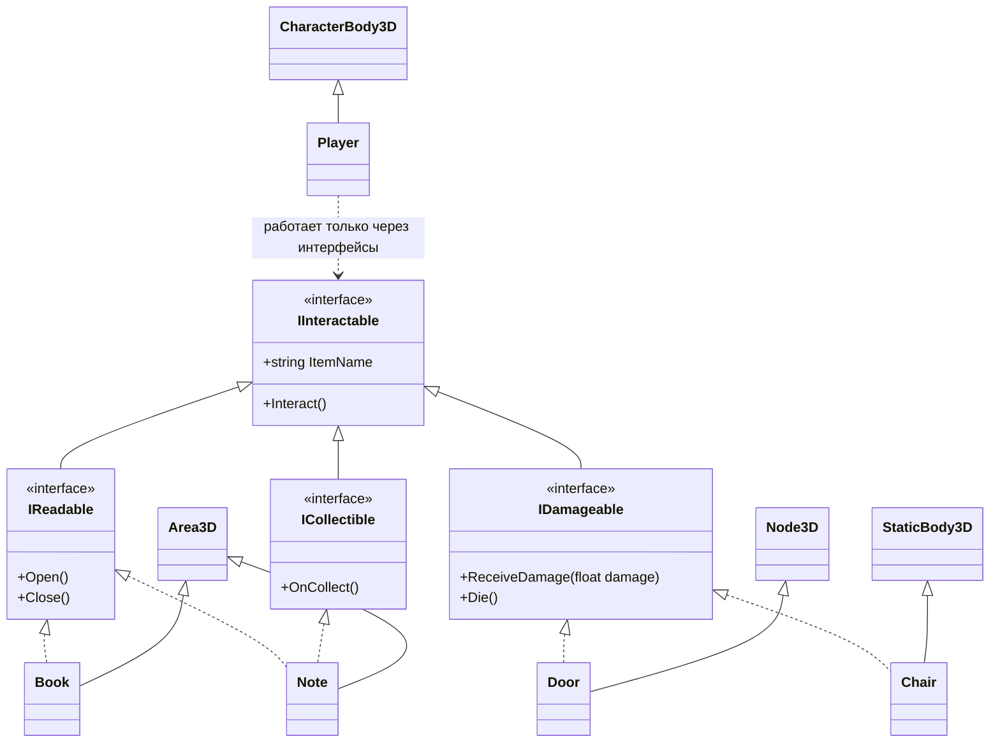
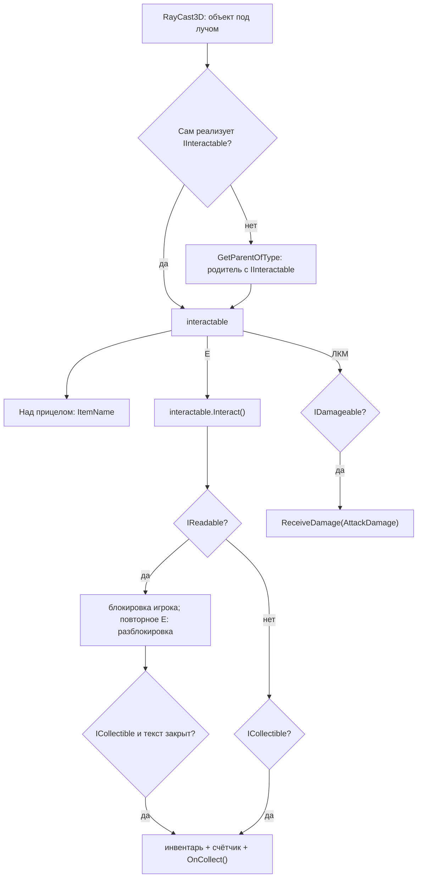

# Квартира от первого лица: полиморфизм через интерфейсы (Практика 4)

## Описание проекта

3D-сцена от первого лица на движке **Godot 4.7** с использованием **C#** (.NET SDK).
Проект демонстрирует полиморфизм через интерфейсы: игрок взаимодействует с объектами
квартиры лучом `RayCast3D` из центра камеры и при этом **не знает конкретных классов**
объектов. Он работает только с контрактами (`IInteractable`, `IReadable`, `ICollectible`,
`IDamageable`), а что именно произойдёт, решает сам объект.

В квартире есть двери, мебель, записки и книги. Дверь открывается и ломается, мебель
только ломается, книгу можно прочитать, а записку можно и прочитать, и подобрать.
Собранные записки считаются счётчиком в левом верхнем углу.

## Управление

| Действие | Клавиши |
|---|---|
| Движение | `W` `A` `S` `D` |
| Осмотр | движение мыши (курсор захвачен) |
| Взаимодействие (открыть дверь, прочитать, закрыть текст) | `E` |
| Атака (сломать дверь или мебель) | ЛКМ |
| Выход из игры | `Esc` |

Над прицелом показывается название объекта, на который направлен луч, например
«Дверь (E/ЛКМ)». Пока открыт текст записки или книги, игрок не двигается и не может
осматриваться. Повторное `E` закрывает текст.

Действия ввода (`left`, `right`, `forward`, `backward`, `interact`, `attack`, `quit`)
задаются в *Проект → Настройки проекта → Input Map*.

## Запуск проекта

1. Установите **Godot 4.7 (.NET версия)** и **.NET SDK**.
2. Откройте `project.godot` в Godot.
3. Нажмите **Build** (значок молотка справа вверху), чтобы собрать C#-сборку.
   Пока сборка не прошла без ошибок, скрипты не подключатся.
4. Откройте `res://scenes/scene.tscn` и запустите сцену (`F6`) либо назначьте её
   главной (*Настройки проекта → Application → Run → Main Scene*) и запускайте `F5`.
5. Убедитесь, что в Input Map созданы все действия из таблицы выше.

## Структура проекта

```
res://
├── interfaces/                  # Контракты (интерфейсы)
│   ├── IInteractable.cs         # базовый: название и взаимодействие
│   ├── IReadable.cs             # читаемые: открыть и закрыть текст
│   ├── ICollectible.cs          # собираемые: последствия подбора
│   └── IDamageable.cs           # разрушаемые: урон и смерть
├── objects/                     # Классы объектов и игрока
│   ├── Player.cs                # игрок: движение, обзор, луч, взаимодействие
│   ├── Door.cs                  # дверь (IDamageable)
│   ├── Chair.cs                 # мебель (IDamageable)
│   ├── Book.cs                  # книга (IReadable)
│   ├── Note.cs                  # записка (IReadable + ICollectible)
│   └── GetParentOfType.cs       # метод расширения: поиск родителя по типу/интерфейсу
├── scenes/
│   ├── scene.tscn               # основная сцена: квартира со всеми объектами
│   ├── player.tscn              # игрок
│   ├── Door.tscn                # дверь
│   ├── Furniture.tscn           # мебель (скрипт Chair.cs)
│   ├── Note.tscn                # записка
│   └── Book.tscn                # книга
├── resources/                   # Модели, звуки
│   ├── apartment_baked/         # модель квартиры
│   ├── door_with_frame/         # модели двери и рамы
│   ├── old_shelves/             # модель мебели и текстуры
│   ├── note/                    # модель записки
│   ├── book/                    # модель книги
│   └── audio/                   # звуки ударов и разрушения
├── scripts/
├── icon.svg
└── README.md
```

## Структура сцен

### scene.tscn (основная сцена)

```
Node3D
├── CharacterBody3D                 (экземпляр player.tscn)
├── Apartment
│   ├── Sketchfab_Scene             (модель квартиры)
│   ├── Sketchfab_Scene2            (вторая часть квартиры)
│   └── Doors
│       ├── Door                    (Door.tscn)
│       ├── Door2                   (Door.tscn)
│       └── Door3                   (Door.tscn)
├── Furnitures
│   ├── Furniture ... Furniture4    (4 × Furniture.tscn)
├── Notes
│   ├── Note ... Note4              (4 × Note.tscn)
└── Books
	└── Book ... Book4              (4 × Book.tscn, у каждой свой текст)
```

### player.tscn

```
CharacterBody3D (Player.cs)
├── MeshInstance3D
├── Camera3D
│   └── RayCast3D                   # длина 3 м, Collide With Areas включён
├── CollisionShape3D
└── CanvasLayer
	├── LabelNotes                  # надпись «Notes:»
	├── LabelItemsNumber            # счётчик собранных записок
	└── CameraLabel                 # название объекта под прицелом
```

Для записок и книг (`Area3D`) у луча включён **Collide With Areas**, иначе он их не видит.

### Door.tscn

```
Door (Node3D, Door.cs)
├── Frame                           # дверная рама (модель)
├── DoorHinge
│   └── Door                        # полотно двери (модель)
├── AnimationPlayer                 # Open, hit, Destroy
└── AudioStreamPlayer3D
```

### Furniture.tscn

```
Furniture (StaticBody3D, Chair.cs)
├── CollisionShape3D
├── closet004 → Object_38 → MeshInstance3D   # модель
├── AnimationPlayer                 # hit, Destroy
└── AudioStreamPlayer3D
```

### Note.tscn и Book.tscn

Обе сцены устроены одинаково и различаются скриптом и моделью.

```
Note (Area3D, Note.cs)  /  Book (Area3D, Book.cs)
├── CollisionShape3D                # сфера, зона попадания луча
├── Sketchfab_Scene                 # модель записки / книги
└── CanvasLayer                     # интерфейс чтения, скрыт при старте
	├── TextureRect (ColorRect)     # затемнение экрана
	├── TextureRect2 (ColorRect)    # «лист» бумаги
	└── RichTextLabel               # текст
```

## Интерфейсы

| Интерфейс | Наследует | Члены | Назначение |
|---|---|---|---|
| **IInteractable** | – | `string ItemName { get; }`, `void Interact()` | Общий контракт всего, с чем можно взаимодействовать. Название показывается над прицелом, `Interact()` вызывается по `E`. |
| **IReadable** | `IInteractable` | `void Open()`, `void Close()` | Читаемые объекты. Открывают и скрывают интерфейс с текстом. |
| **ICollectible** | `IInteractable` | `void OnCollect()` | Собираемые объекты. Описывают, что происходит с объектом после подбора. |
| **IDamageable** | `IInteractable` | `void ReceiveDamage(float damage)`, `void Die()` | Разрушаемые объекты. Получают урон и умирают. |

## Классы

Все классы Godot объявлены `partial` с атрибутом `[GlobalClass]`, настраиваемые числа и
узлы вынесены в `[Export]`.

| Класс | Базовый тип | Интерфейсы | Назначение |
|---|---|---|---|
| **Player** | `CharacterBody3D` | – | Движение по WASD, обзор мышью, выход. Каждый кадр ищет объект под лучом и показывает его название. По `E` вызывает `Interact()`, по ЛКМ наносит урон. Ведёт инвентарь и счётчик записок. |
| **Door** | `Node3D` | `IDamageable` | 50 единиц здоровья (`health`). По `E` проигрывает анимацию `Open` вперёд, если закрыта, и назад, если открыта. При ударе проигрывает `hit`, при смерти `Destroy`, после чего удаляется. |
| **Chair** | `StaticBody3D` | `IDamageable` | Разрушаемая мебель. `Interact()` ничего не делает. При ударе проигрывает `hit`, при смерти `Destroy`, после чего удаляется. Здоровье по умолчанию 10 (`health`), в `Furniture.tscn` для экземпляра задано 30. |
| **Book** | `Area3D` | `IReadable` | Читаемая книга, у каждого экземпляра свой `Text`. `E` открывает текст, повторное `E` закрывает. Книга остаётся в мире. |
| **Note** | `Area3D` | `IReadable`, `ICollectible` | Записка: `E` открывает текст, повторное `E` закрывает. После закрытия игрок подбирает записку автоматически: она попадает в инвентарь, счётчик растёт, а `OnCollect()` удаляет её со сцены. |
| **NodeExtensions** | статический класс | – | Метод расширения `GetParentOfType<T>()`: ищет вверх по дереву ближайшего родителя нужного типа. Нужен, когда луч попал в дочерний коллайдер, а скрипт висит на родителе. |

Основные экспортируемые параметры:

| Класс | Параметр | Значение по умолчанию | Смысл |
|---|---|---|---|
| Player | `Speed` | 5.0 | скорость движения |
| Player | `MouseSensitivity` | 0.002 | чувствительность мыши |
| Player | `AttackDamage` | 10 | урон от одного удара |
| Door | `health` | 50 | здоровье двери |
| Chair | `health` | 10 | здоровье мебели |
| Door, Chair, Note, Book | `ItemName` | название объекта | текст над прицелом |
| Note, Book | `Text` | – | отображаемый текст, у каждого экземпляра свой |

## Иерархия классов и интерфейсов

### Реализация интерфейсов



Классы `Note` (читаемая и собираемая) и интерфейсы-наследники `IInteractable` показывают,
что объект реализует **несколько контрактов сразу**, а игрок обращается к каждому из них
независимо.

### Как игрок взаимодействует с объектом



### Объекты и интерфейсы

| Объект | IInteractable | IReadable | ICollectible | IDamageable | `Interact()` по `E` | ЛКМ |
|---|:-:|:-:|:-:|:-:|---|---|
| Door | ✔ | | | ✔ | открыть или закрыть | урон |
| Chair (Furniture) | ✔ | | | ✔ | ничего | урон |
| Book | ✔ | ✔ | | | открыть или закрыть текст | – |
| Note | ✔ | ✔ | ✔ | | открыть или закрыть текст, подбор после закрытия | – |

## Как работает полиморфизм в проекте

- **Игрок не знает конкретных классов.** `Player` проверяет только интерфейсы
  (`is IReadable`, `is ICollectible`, `is IDamageable`) и вызывает их методы. Добавить
  новый объект можно, не меняя `Player`.
- **Одинаковый вызов, разное поведение.** `interactable.Interact()` у двери проигрывает
  анимацию, у мебели ничего не делает, у книги и записки открывает окно с текстом.
- **Несколько интерфейсов в одном классе.** `Note` реализует `IReadable` и `ICollectible`:
  её можно прочитать и после закрытия текста подобрать.
- **Один интерфейс, разные классы.** `IDamageable` реализуют и `Door`, и `Chair`, при этом
  у каждого свои анимации и своё здоровье.
- **Объекты управляют собой.** Дверь знает, как открываться, записка знает, как показывать
  текст. Игрок только передаёт команду.

## Автор

Осокина Екатерина Алексеевна 562035
